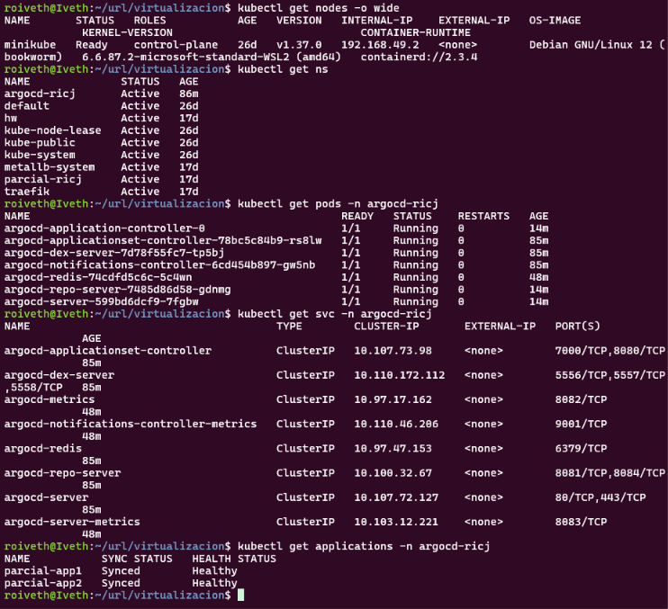
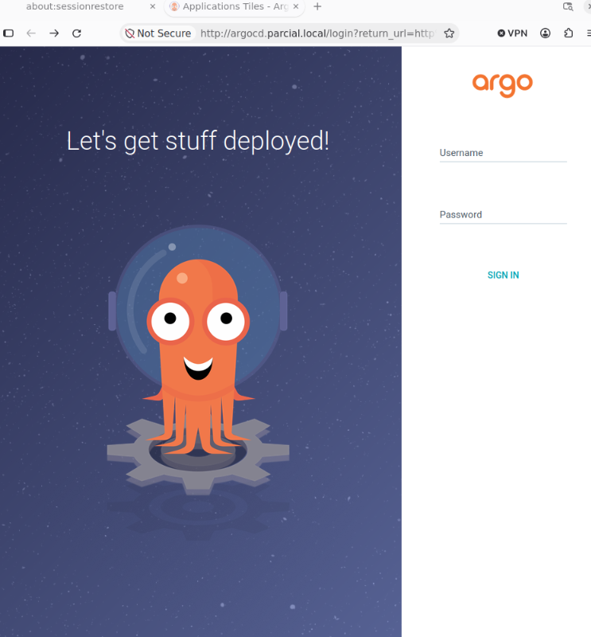
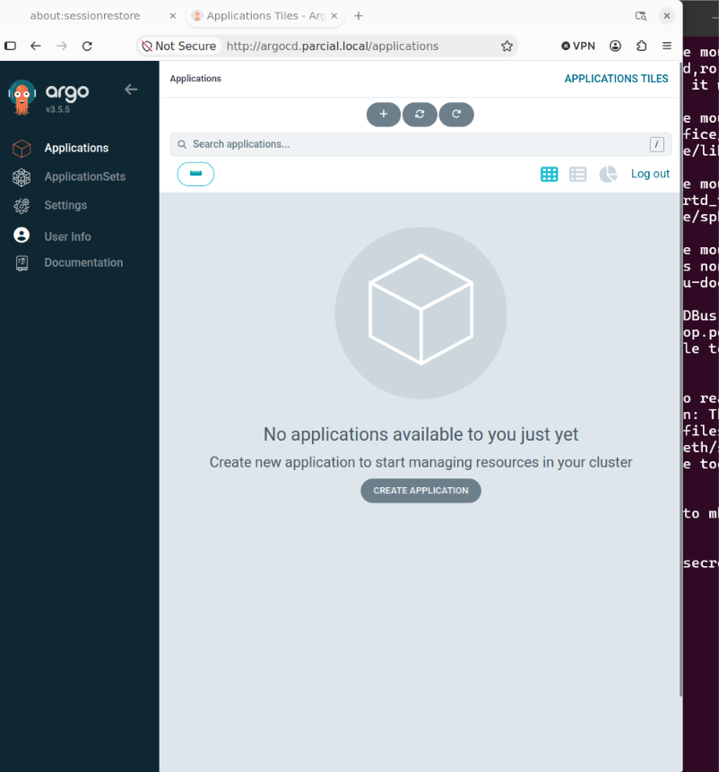
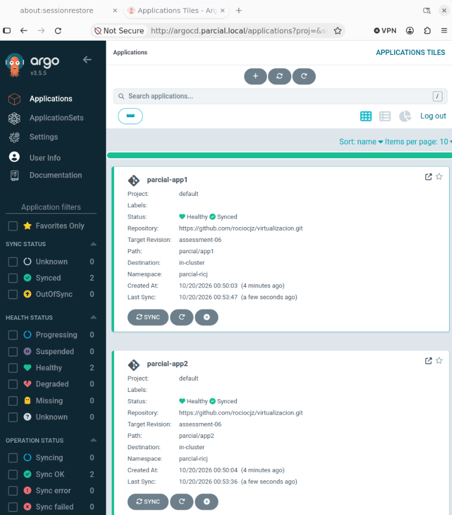
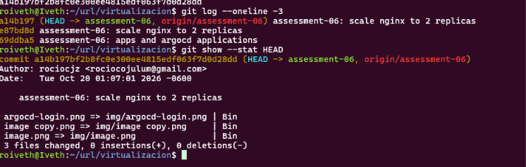
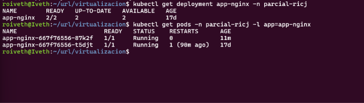
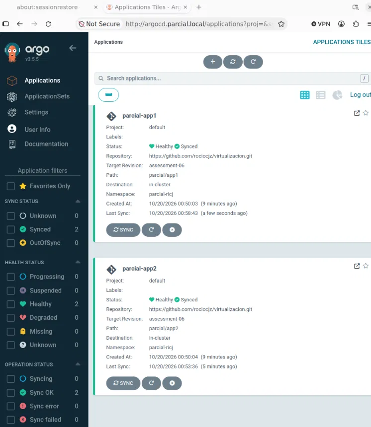

# virtualizacion
# Assessment 06

**Student:** Rocio Iveth Cojulum Juarez
**Branch:** `assessment-06`

## Environment

- Kubernetes running on Minikube (Docker driver, Ubuntu on WSL).
- MetalLB for `LoadBalancer` services.
- Traefik as the ingress controller.
- Argo CD installed in the `argocd-ricj` namespace.
- Applications deployed in the `parcial-ricj` namespace.
- GitHub repository: `rociocjz/virtualizacion`.
- Git branch: `assessment-06`.

## Repository Structure

```
.
├── argocd/
│   ├── values.yaml
│   ├── ingressroute.yaml
│   ├── fix-rbac.sh
│   ├── application-app1.yaml
│   └── application-app2.yaml
```

## 1. Argo CD Installation

Argo CD was installed with Helm in its own namespace, `argocd-ricj`. The configuration is stored in `argocd/values.yaml`, which enables HTTP mode (`server.insecure`) so Traefik can route to the interface without terminating TLS:

```yaml
configs:
  params:
    server.insecure: true
```

```bash
helm repo add argo https://argoproj.github.io/argo-helm
helm repo update
helm install argocd argo/argo-cd \
  --namespace argocd-ricj --create-namespace \
  -f argocd/values.yaml
kubectl get pods -n argocd-ricj
helm list -n argocd-ricj
```

All Argo CD pods reached the `Running` state.

### RBAC fix

After creating the Applications, they stayed in `Unknown` status. The application controller reported that its service account could not list cluster-scoped resources (`roles.rbac.authorization.k8s.io is forbidden`). The cause was that the cluster role bindings did not reference the `argocd-ricj` namespace. The subjects were fixed (`argocd/fix-rbac.sh`) and the Argo CD components were restarted. After that, both Applications moved to `Synced` and `Healthy`.

Verification that the bindings now point to the correct namespace:

```bash
kubectl get clusterrolebinding argocd-application-controller \
  -o jsonpath='{.subjects[0].namespace}{"\n"}'
```

```
argocd-ricj
```
### Cluster status and Argo CD resources



## 2. Exposing Argo CD Through Traefik

An `IngressRoute` sends the domain `argocd.parcial.local` to the `argocd-server` service (`argocd/ingressroute.yaml`):

```yaml
apiVersion: traefik.io/v1alpha1
kind: IngressRoute
metadata:
  name: argocd-server
  namespace: argocd-ricj
spec:
  entryPoints:
    - web
  routes:
    - match: Host(`argocd.parcial.local`)
      kind: Rule
      services:
        - name: argocd-server
          port: 80
```

```bash
kubectl apply -f argocd/ingressroute.yaml
kubectl get ingressroute -n argocd-ricj
```

### Local DNS

The domain was added to `/etc/hosts`:

```
127.0.0.1 nginx.parcial.local httpd.parcial.local whoami.parcial.local echo.parcial.local argocd.parcial.local
```

> **Note about WSL:** MetalLB assigned `192.168.49.200` to the Traefik `LoadBalancer`, but the Docker network is not reachable from the Windows/WSL host. Port 80 of the Traefik service is forwarded to `127.0.0.1`, so the domain resolves to `127.0.0.1`. On a setup where the LoadBalancer IP is reachable, the entry would point to `192.168.49.200`.
>
> ```bash
> sudo $(which kubectl) --kubeconfig $HOME/.kube/config \
>   port-forward -n traefik svc/traefik 80:80 --address 127.0.0.1
> ```

### Web interface access



### Argo CD dashboard



## 3. Applications

Two Argo CD Applications were created to deploy the applications of the `parcial-ricj` namespace from the GitHub repository.

| Application | Path in the repository | Manages |
|---|---|---|
| `parcial-app1` | `parcial/app1` | `app-nginx`, `app-httpd` |
| `parcial-app2` | `parcial/app2` | `app-whoami`, `app-echo` and the IngressRoutes |

Their definitions are stored in `argocd/application-app1.yaml` and `argocd/application-app2.yaml`:

```yaml
apiVersion: argoproj.io/v1alpha1
kind: Application
metadata:
  name: parcial-app1
  namespace: argocd-ricj
spec:
  project: default
  source:
    repoURL: https://github.com/rociocjz/virtualizacion.git
    targetRevision: assessment-06
    path: parcial/app1
  destination:
    server: https://kubernetes.default.svc
    namespace: parcial-ricj
  syncPolicy:
    automated:
      prune: true
      selfHeal: true
```

Both Applications use the `assessment-06` branch of the repository and the `parcial-ricj` destination namespace. Automated synchronization is enabled.

```bash
kubectl apply -f argocd/application-app1.yaml
kubectl apply -f argocd/application-app2.yaml
kubectl get applications -n argocd-ricj
```

## 4. Synchronization Test

### Status before the change

Both Applications reported `Synced` and `Healthy`.



### Applying a change through GitHub

To test automated synchronization, the replica count of the `app-nginx` Deployment was changed from one to two in `parcial/app1/01-app-nginx.yaml`:

```bash
sed -i 's/replicas: 1/replicas: 2/' parcial/app1/01-app-nginx.yaml
git add parcial/app1/01-app-nginx.yaml
git commit -m "assessment-06: scale nginx to 2 replicas"
git push
```



The change was pushed to the `assessment-06` branch. Argo CD detected the new commit and synchronized the cluster without any manual `kubectl` change.

### Results after synchronization

Verification commands:

```bash
kubectl get applications -n argocd-ricj
kubectl get deployment app-nginx -n parcial-ricj
kubectl get pods -n parcial-ricj -l app=app-nginx
```



Both Applications remained `Synced` and `Healthy` after the change.



## Final Results

- `parcial-app1`: `Synced` and `Healthy`.
- `parcial-app2`: `Synced` and `Healthy`.
- `app-nginx` Deployment: two desired replicas and two available replicas.