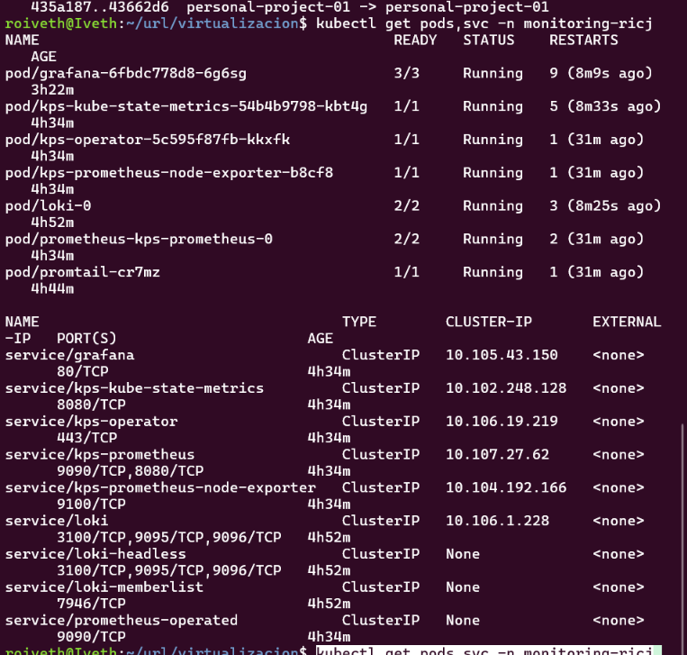
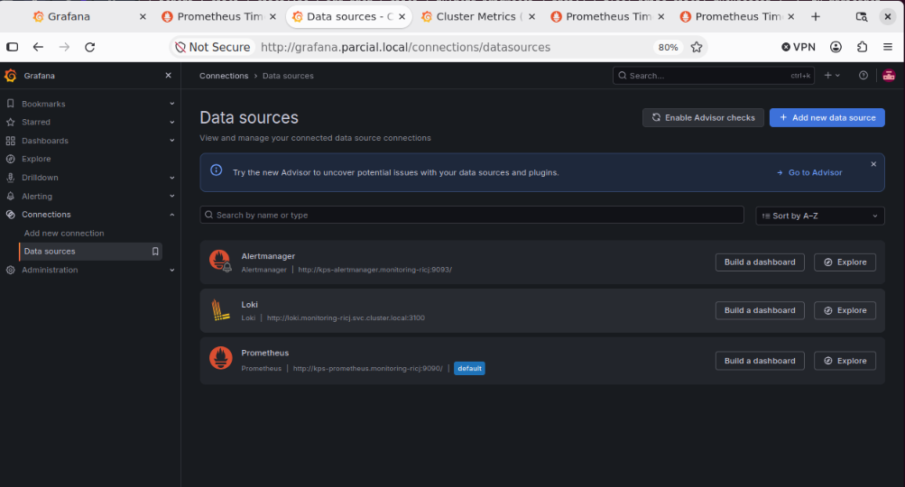
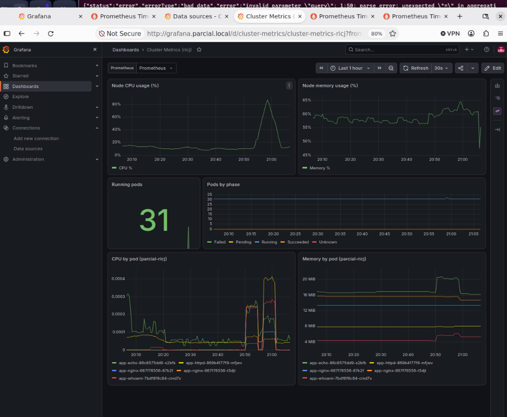
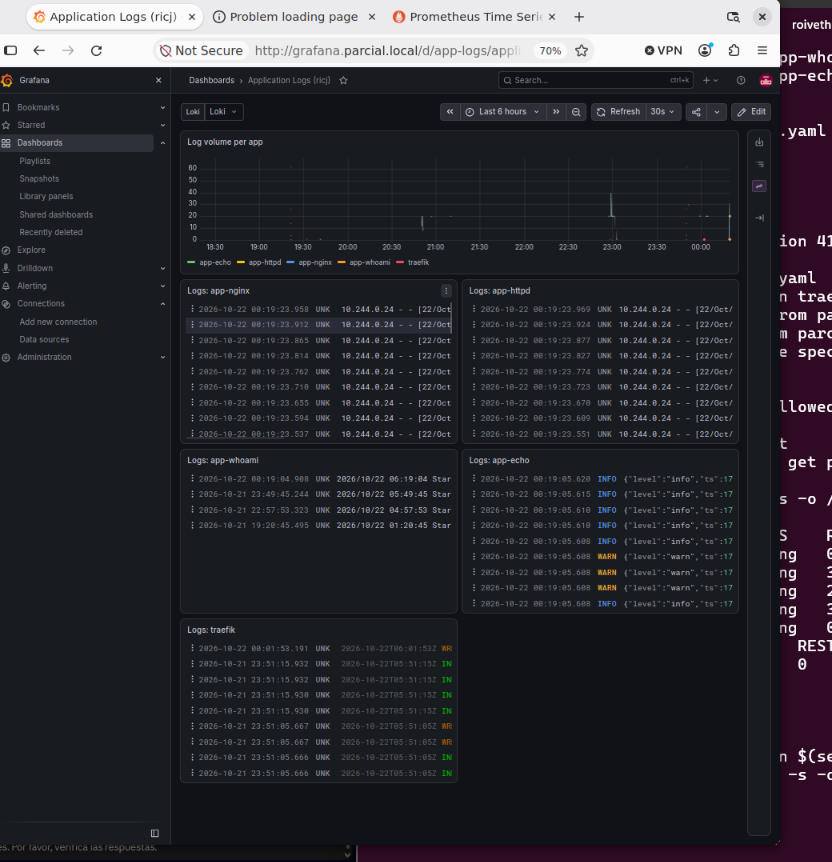
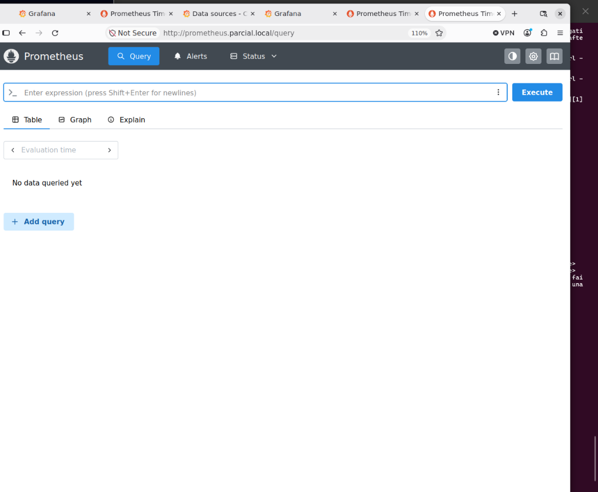
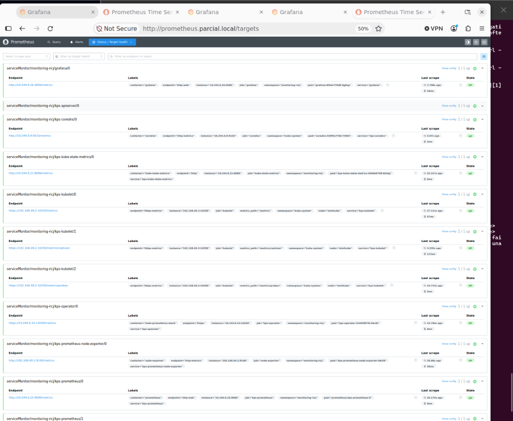
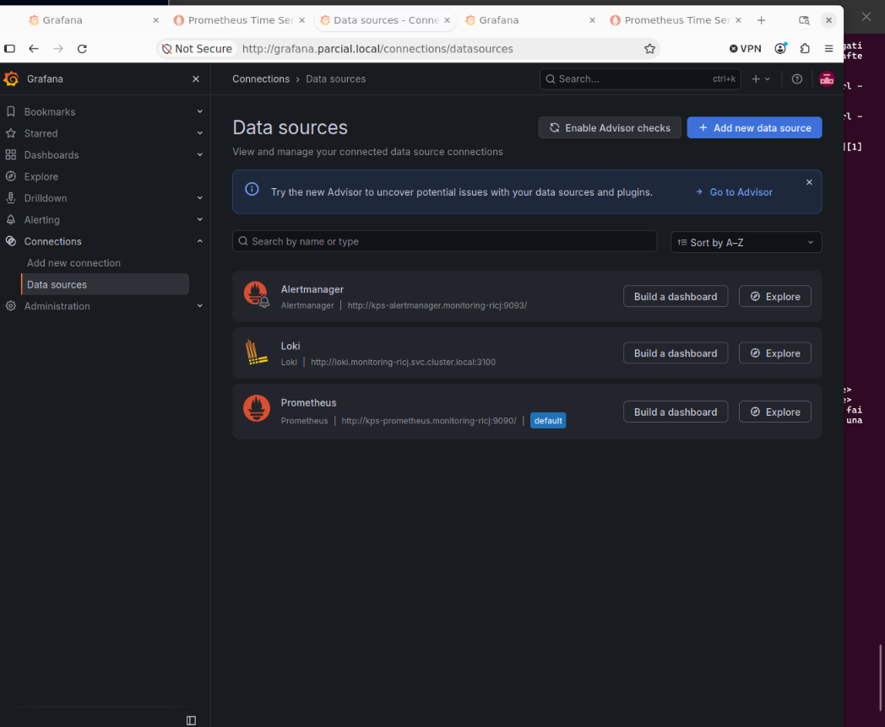

# virtualizacion
# Personal Project 01: Monitoring Stack on Kubernetes

**Student:** Rocio Iveth Cojulum Juarez
**Branch:** `personal-project-01`
**Namespace:** `monitoring-ricj`

A monitoring stack (Prometheus, Loki, Promtail and Grafana) deployed on the Minikube cluster from the previous assessments. Grafana and Prometheus are exposed through Traefik using the MetalLB LoadBalancer IP.

## Environment

- Kubernetes on Minikube (Docker driver, Ubuntu on WSL).
- MetalLB provides the LoadBalancer IP `192.168.49.200`.
- Traefik is the ingress controller.
- Applications in the `parcial-ricj` namespace: nginx, httpd, whoami and echo.
- Every component of the stack runs in a single namespace: `monitoring-ricj`.

| Component | Chart | Version |
|---|---|---|
| Loki | `grafana-community/loki` | 19.0.3 (Loki 3.7.9) |
| Promtail | `grafana/promtail` | 6.17.1 |
| Prometheus + Grafana | `prometheus-community/kube-prometheus-stack` | 92.11.0 |

## Repository Structure

```
monitoring/
├── loki/
│   └── values.yaml
├── promtail/
│   └── values.yaml
├── prometheus/
│   └── values.yaml                  # Prometheus, Grafana and data sources
├── traefik/
│   └── values-access-logs.yaml      # Traefik access log
├── ingressroutes.yaml               # Grafana and Prometheus routes
└── grafana/
    ├── generate.py                  # generates the dashboard JSON files
    ├── dashboards/
    │   ├── cluster-metrics.json
    │   └── app-logs.json
    └── provisioning/
        ├── dashboard-cluster-metrics.yaml   # ConfigMap
        └── dashboard-app-logs.yaml          # ConfigMap
img/                                 # Screenshots
```

## 0. Preparation

The memory limit of the Minikube container was raised from 3 GiB to 5 GiB, because the stack did not fit in the default limit:

```bash
docker update --memory 5g --memory-swap 5g minikube
```


## 1. Loki

Loki runs in single-binary mode with filesystem storage and a 5 Gi volume. The optional components (gateway, caches, canary and MinIO) are disabled to save memory. The configuration is in `monitoring/loki/values.yaml`.

```bash
helm install loki grafana-community/loki --version 19.0.3 \
  --namespace monitoring-ricj --create-namespace \
  -f monitoring/loki/values.yaml
```

Inside the cluster, Loki is available at `http://loki.monitoring-ricj.svc.cluster.local:3100`.

## 2. Promtail

Promtail runs as a DaemonSet and sends the logs to Loki. A relabel rule keeps only the logs of the `parcial-ricj` and `traefik` namespaces, which covers the 4 applications and Traefik (`monitoring/promtail/values.yaml`):

```yaml
config:
  clients:
    - url: http://loki.monitoring-ricj.svc.cluster.local:3100/loki/api/v1/push
  snippets:
    extraRelabelConfigs:
      - action: keep
        source_labels:
          - __meta_kubernetes_namespace
        regex: parcial-ricj|traefik
```

```bash
helm install promtail grafana/promtail --version 6.17.1 \
  --namespace monitoring-ricj \
  -f monitoring/promtail/values.yaml
```


Verification that Loki received logs from both namespaces and from each application:

```bash
curl -s http://127.0.0.1:3100/loki/api/v1/label/namespace/values
curl -s http://127.0.0.1:3100/loki/api/v1/label/app/values
```

```
{"status":"success","data":["parcial-ricj","traefik"]}
{"status":"success","data":["app-echo","app-httpd","app-nginx","app-whoami","traefik"]}
```

## 3. Prometheus and Grafana

Both are installed with `kube-prometheus-stack` (`monitoring/prometheus/values.yaml`). Main settings:

- Alertmanager is disabled to save memory.
- The `etcd`, `scheduler`, `controller-manager` and `kube-proxy` monitors are disabled, because Minikube does not expose them and they would stay `DOWN`.
- Memory limits for Prometheus, Grafana, node-exporter and kube-state-metrics.
- Scrape and evaluation interval of 60 seconds and a retention of 12 hours, to reduce disk load.
- Grafana root URL set to `grafana.parcial.local`.

```bash
helm install kps prometheus-community/kube-prometheus-stack --version 92.11.0 \
  --namespace monitoring-ricj \
  -f monitoring/prometheus/values.yaml --timeout 10m
```

Pods and services of the stack:



## 4. Grafana data sources as code

The data sources are provisioned from `values.yaml`, not created in the interface. The chart provisions Prometheus, and Loki is added with `additionalDataSources`:

```yaml
grafana:
  additionalDataSources:
    - name: Loki
      type: loki
      access: proxy
      url: http://loki.monitoring-ricj.svc.cluster.local:3100
      isDefault: false
```



## 5. Dashboards as code

Two dashboards are generated as JSON files by `monitoring/grafana/generate.py`. They are loaded as ConfigMaps labeled `grafana_dashboard=1`, which the Grafana sidecar detects automatically:

```bash
python3 monitoring/grafana/generate.py
kubectl apply -f monitoring/grafana/provisioning/
```

### Cluster Metrics

Shows node CPU and memory usage, running pods, pods by phase, and CPU and memory by pod in `parcial-ricj`.



### Application Logs

Queries Loki and shows a log panel for each of the 4 applications and one for Traefik, plus a graph of the log volume per application.



Traefik does not write access logs by default, so they were enabled (`monitoring/traefik/values-access-logs.yaml`):

```bash
helm upgrade traefik traefik/traefik --version 41.6.1 -n traefik \
  --reuse-values \
  -f monitoring/traefik/values-access-logs.yaml
```

## 6. Exposure through Traefik

Grafana and Prometheus are exposed with `IngressRoute` resources (`monitoring/ingressroutes.yaml`):

| Domain | Service | Port |
|---|---|---|
| `grafana.parcial.local` | `grafana` | 80 |
| `prometheus.parcial.local` | `kps-prometheus` | 9090 |

```bash
kubectl apply -f monitoring/ingressroutes.yaml
kubectl get ingressroute -n monitoring-ricj
```

## 7. Local DNS

Two new domains were added to `/etc/hosts`, next to the ones from the previous assessments:

```
127.0.0.1 nginx.parcial.local httpd.parcial.local whoami.parcial.local echo.parcial.local argocd.parcial.local grafana.parcial.local prometheus.parcial.local
```

> **Note about WSL:** MetalLB assigned `192.168.49.200` to the Traefik LoadBalancer, but that Docker network is not reachable from the host. Port 80 of the Traefik service is forwarded to `127.0.0.1`, so the domains resolve to `127.0.0.1`. On a setup where the LoadBalancer IP is reachable, the entry would point to `192.168.49.200`.
>
> ```bash
> sudo $(which kubectl) --kubeconfig $HOME/.kube/config \
>   port-forward -n traefik svc/traefik 80:80 --address 127.0.0.1
> ```

## 8. Browser access

### Prometheus



### Prometheus targets

All the targets are in the `UP` state.



### Grafana



## Troubleshooting and known issues

- **Grafana target `DOWN`:** the first scrape timed out right after a restart (`context deadline exceeded`). Restarting the Grafana deployment fixed it.
- **Log panels with "No data":** whoami, echo and Traefik do not log every request by default. Restarting their pods and enabling the Traefik access log fixed it.
- **Pods restarting at the same time:** after resuming the cluster, several pods restarted together because `etcd` timed out (`etcdserver: request timed out`), probably due to slow disk I/O in WSL. To reduce the load, the Prometheus scrape interval was raised to 60 seconds and its retention was reduced to 12 hours.
- **Memory:** the Minikube container memory limit was raised from 3 GiB to 5 GiB.